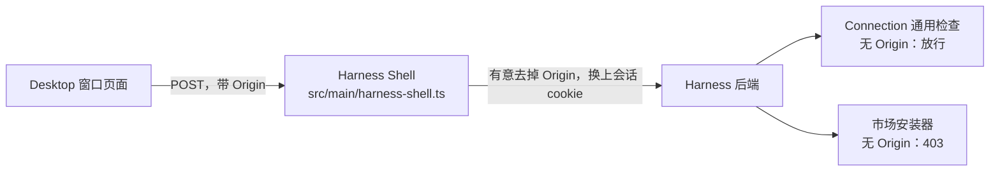

# 本 fork 的本地修复与构建方式

> 适用于 `laiyinyizao007/dsh-desktop`（上游 `dataelement/dsh-desktop`）。记录本 fork 相对上游额外维护的修复、为什么这样修、以及怎么打包才不会丢修复。最后更新：2026-11-01。

## 1. 一句话

本地打包必须用 **`build/local`** 分支：它 = 当前功能分支 + 下表两个修复。从别的分支（包括上游 `main`）打包，Windows 下 Word 模板会失败，窗口内安装插件市场也会失败。

## 2. 修复清单

| 修复 | 分支 / 提交 | 推送状态 | 跟踪 | 状态 |
|------|-------------|----------|------|------|
| Windows 标准用户下 Word 模板 worker 启动失败（`EPERM mkdir C:\WINDOWS\dsh-acl-locks`） | `fix/docx-worker-windows-temp` / `32d8545` | 已推到 fork | fork Issue #1 | 使用中 |
| 窗口内安装 / 卸载插件市场被拒（403 `Request rejected.`） | `fix/market-installer-connection-fence` / `71a2c71` | 已推到 fork，**未向上游提 issue / PR** | 本文第 4 节 | 使用中 |
| （弃用）在 Harness Shell 里补回 Origin | `fix/shell-forward-origin` / `cda4dde` | 仅本地 | 本文第 4.5 节 | **不再使用**，违背上游设计 |

## 3. 本地构建分支 `build/local`

组成（全部 `--no-ff` 合并，无冲突）：

```text
build/local
├── feat/responsive-web-ui                  # 当前功能分支（窄屏适配，fork Issue #2）
├── fix/docx-worker-windows-temp            # 32d8545
└── fix/market-installer-connection-fence   # 71a2c71（基于上游 main，合并时顺带引入上游 #822，只改 macOS 打包配置）
```

- 只存在于本地，不推送：其中的功能分支尚未发布。
- 旧的构建分支已改名为 `build/local-shellfix`（含弃用的 Shell 修法），仅作备份。
- 有新功能或新修复时，在 `build/local` 上再合并一次；**不要把修复直接合进功能分支**，否则功能分支将来提 PR 会夹带无关改动。

### 打包前检查

```bash
npx vitest run test/market-installer.test.js test/harness-shell.test.ts \
  test/docx-template-fidelity.test.mjs test/window-permissions.test.mjs
npm run typecheck
npm run build
```

构建后核对：

- `out/main/index.js` 中**不应**出现 `headers.set("origin", backend.origin)`（Shell 行为应与上游一致）；
- `packages/dsh-desktop-market-installer/index.js` 中应有 `connection.requestRejection(req)`。

2026-11-01 在 `build/local` 上实测：上述 4 个测试文件 64 例通过，typecheck、build 通过。**尚未重新打包并在窗口内端到端验证。**

## 4. 插件市场安装被拒：来龙去脉

### 4.1 现象

在 Desktop **窗口内**点"安装插件市场"，界面先显示安装中，随后回到原状，没有任何错误提示。同样的操作在普通浏览器标签页里打开 Harness 地址则正常。能力库（dsh-skill-mcp-manager）的开关报 `untrusted origin` 也是同一原因。

### 4.2 原因：两条规则不一致



- v0.13.0 起，窗口内的页面请求都经 Harness Shell 转发。Shell **有意**不带 `Origin`：上游 `test/harness-shell.test.ts` 明确断言转发后的 `origin`、`sec-fetch-site` 为 undefined。
- Harness 的通用检查（`@deepseek-ai/dsh-client-connection` 的 `isTrustedApiRequest` 与 `admit()`）：Host 必须是本机；`sec-fetch-site` 不能是 `cross-site`；**没有 Origin 放行**，有则必须同源；另外必须带有效的浏览器会话 cookie（`HttpOnly; SameSite=Strict`，跨站页面带不上）。
- 市场安装器 `packages/dsh-desktop-market-installer/index.js` 的 `isTrustedRequest(req, true)` 却要求写请求**必须**带同源 Origin，于是窗口内的安装 / 卸载一律 403。前端先乐观地显示"安装中"，随后状态轮询回答 `absent` 并清掉错误，所以看起来像"自动取消"。

### 4.3 修法：让安装器遵守 Harness 规则（不改 Shell）

`71a2c71`：

- `isTrustedRequest(req, mutation, connection)` 新增可选参数。Harness Connection 服务可用时，写操作改由 `connection.requestRejection(req)` 判断（公开 API，类型见 `dsh-client-connection/lib/types/rpc.d.ts`，返回 `401 | 403 | undefined`）。
- 两个写路由用 `webCtx.get('connection')` 取得该服务；取不到时保留原来的同源 Origin 规则。
- 本机 socket 与转发头检查仍然先执行，Connection 检查不能放宽它们。
- 比原来更严：原来只看 Origin，不验会话 cookie。
- 测试：`test/market-installer.test.js` 新增 1 例（Shell 转发形态放行、无 cookie 401、跨站 Origin 403、非本机与转发头仍拒绝且不调用 Connection、无服务时保留旧规则），共 19 例通过。

### 4.4 其它受影响的插件（第三方，本 fork 不修）

在本机已装插件中核对过写接口对"无 Origin"的处理：

| 插件 | 无 Origin 的写请求 | 处理 |
|------|--------------------|------|
| dsh-skill-mcp-manager 1.2.2（alone-tree） | 拒绝（`untrusted origin`） | 未报告作者；期间在浏览器标签页操作 |
| dsh-rss 0.9.6（STARDUSTLC666） | 拒绝 | 同上 |
| dsh-calendar、dsh-notify-me、dsh-unlag、skill-explorer | 放行（与 Harness 一致） | 不受影响 |

### 4.5 为什么不在 Shell 里补回 Origin

最初的修法 `cda4dde` 让 Shell 对非 GET 请求补上 `origin = 后端地址`。它能解决问题，但推翻了上游刻意测试过的设计（要把上游那条断言改掉），所以弃用。分支保留在本地，不合并、不提交上游。

### 4.6 为什么上游没人报（推断，未实测）

官方安装包不预装插件市场，只放"安装插件市场"占位按钮（`build/dsh-desktop.patch.yml`）。装好后由 dshmarket 接管界面，之后安装其它插件不走这个接口。从 v0.12.x 升级上来的用户早已装好市场，不会再点这个按钮；只有**全新的 profile**（例如开发版的 `dsh-desktop-dev`）才会撞上。所以"官方能用、自编译不行"的差别在于"市场是否已经装好"，而不是官方版与自编译版本身。

要实测，须在从没装过 DSH 的环境里装官方 v0.13.0，再在窗口内点一次"安装插件市场"。2026-11-01 决定暂不实测。

### 4.7 对上游的处理

- 2026-11-01 决定：**暂不向上游提 issue 或 PR**。理由：问题只影响全新 profile，且上述推断未在官方安装包上实测。
- 若以后要提：先完成 4.6 的实测，再只提 issue（写现象、原因、建议修法，由维护者选方向）；维护者认可后再以 `fix/market-installer-connection-fence` 开 PR。
